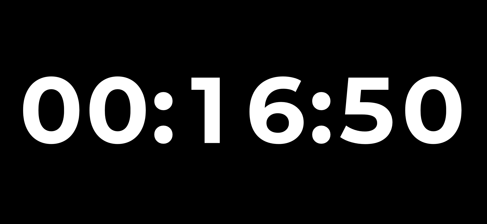
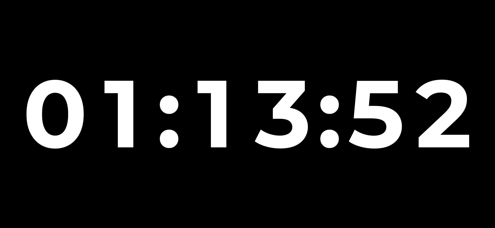

# AMOLED Stopwatch

Минималистичный полноэкранный секундомер для Android. Только время на чёрном экране.

[English](README.md) · [Сборка](docs/BUILDING.md) · [MIT](LICENSE)

- Чёрный AMOLED-фон. Крупные цифры Montserrat 700.
- Горизонтальное положение в обе стороны.
- Часы, минуты, секунды. Без меню, подписей и кнопок.
- Без рекламы, аналитики, сети, аккаунтов и разрешений.

| Нажатие на цифры | Действие |
| --- | --- |
| Тап | Старт, пауза, продолжение |
| Двойной тап на паузе | Сброс |

Пока приложение открыто, экран не гаснет. При сворачивании или блокировке
телефона отсчёт продолжается. После перезагрузки восстанавливается последнее
сохранённое показание на паузе.

Цифры обновляются раз в секунду и немного сдвигаются раз в минуту, включая
паузу. Сдвиг — мера против выгорания, а не гарантия защиты. Яркость и физическую
частоту обновления экрана задаёт система.

Ещё скриншот

## Сборка

Android 8.0+. Нативный Java, без сторонних библиотек и Gradle.
[Инструкция сборки APK](docs/BUILDING.md).

## Лицензия

Код — [MIT](LICENSE). Облегчённый Montserrat — [SIL OFL 1.1](app/src/main/assets/licenses/Montserrat-OFL.txt).
